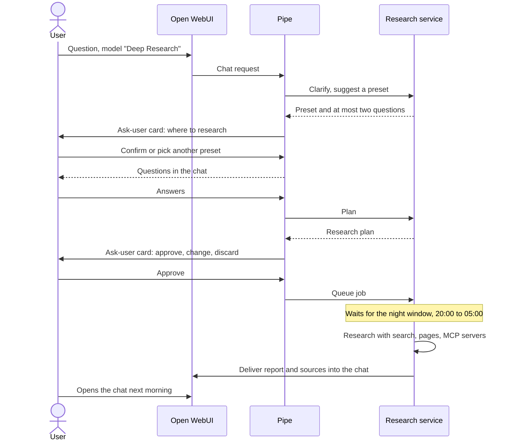

# Deep research

Deep research answers a question with a cited report instead of a chat reply. A user picks the model "Deep Research" in Bebbi Bot, confirms where to research (the service suggests a profile such as Recht or Grosser Rat), answers at most two clarifying questions, approves a research plan, and gets a German report with numbered sources back in the same chat. Jobs run at night, because one report takes minutes of model time and the GPUs are busy during office hours.

The agent lives in its own repository, [DCC-BS/bebbi-deep-research](https://github.com/DCC-BS/bebbi-deep-research). Open WebUI reaches it through a pipe. This page first explains what a pipe is, then how the agent works.

## What is a pipe?

In Open WebUI a model is normally an endpoint behind an OpenAI-compatible API. A pipe is a Python function that Open WebUI shows in the model picker like any other model, but whose answer comes from code you wrote. Open WebUI calls the pipe with the chat request, and whatever the pipe returns or streams becomes the assistant's message. The pipe can call an LLM, a different API, or run a whole program.

The [official documentation](https://docs.openwebui.com/features/extensibility/plugin/functions/pipe/) describes the full interface. The parts that matter here:

* **Class and method.** A pipe is a class `Pipe` with a `pipe(self, body, ...)` method. `body` holds the messages and parameters of the request.
* **Manifold.** If the class also defines `pipes()`, it returns a list of models and Open WebUI lists each one separately. One file can then provide many models. Open WebUI names them `<function id>.<model id>`.
* **Injected arguments.** The method may ask for `__user__` (the caller), `__event_emitter__` (send status lines, source citations or replacement text to the chat), `__event_call__` (ask the user something and wait for the answer), `__request__` and `__task__`. Open WebUI fills in whatever the signature names.
* **Valves.** A `Valves` class defines settings that an admin edits in the UI, such as a service URL or a token.
* **Admin only.** A pipe runs arbitrary code on the server, so only admins can install one. Ours is installed by the [seeder](/apps/bebbi-bot/seeder-janitor.md).

Pipes are one of three function types, next to filters and actions. See [Tools and workspace content](/apps/bebbi-bot/tools.md#tools-functions-and-skills-in-open-webui) for the difference between those and tools.

Why a pipe and not a tool? A tool is something the model chooses to call in the middle of an answer. Deep research is a different product: it has its own conversation flow, can take hours, and must not be steered by a chat model's guesses. The pipe takes over the whole turn.

## How a research run goes



1. **Choose the preset.** The service suggests the research profile that fits the task. The user sees an ask-user card "Wo soll recherchiert werden?" with the suggestion first and the other presets below, each with a short description. Closing the card starts nothing.
2. **Clarify.** The service asks at most two questions, and only when the task is unclear. The user answers or writes "weiter".
3. **Plan.** The service writes a plan of sub-questions. The user sees it in Open WebUI's ask-user card with three buttons: approve, change, discard. "Change" opens an input box, and the plan is rewritten and shown again, up to three times. Closing the card or letting it time out counts as discard, and nothing runs.
4. **Queue.** After approval the job goes into a queue in PostgreSQL. It starts inside the night window, 20:00 to 05:00 in Europe/Zurich. The service could start a quick run of a focus preset during the day, but the pipe currently queues every job for the night.
5. **Research.** The service searches the web, reads pages and calls MCP servers, collects evidence with verbatim quotes, and writes the report.
6. **Delivery.** The finished report replaces the "queued" text in the user's chat, with sources as numbered badges and a source list. A button under the message adds a Word file.

While a job waits or runs, a message that is only "abbrechen" (or "Recherche abbrechen", "stopp") cancels it. A later message in the same chat before the delivery returns the job's status, or the report if the delivery failed.

The user can say "schnell" or "gründlich" in the question to choose a quick or deep run. Quick, standard and deep differ in rounds, number of sub-questions and a hard token cap per run (200k, 450k, 900k tokens).

## Presets

Each preset is a research profile. The user chooses it in the card at the start. With the valve `PRESET_MODELS` on, the pipe also lists one model per preset ("Deep Research · Recht" and so on), which skips the choice. That was the original setup and is off today.

| Label | Preset | Sources |
|---|---|---|
| Recht | `rechtsrecherche` | Federal and cantonal legislation and court decisions through OpenCaseLaw, plus the web |
| Grosser Rat | `grossrat` | All business of the Grosser Rat since 1973 through its MCP server |
| Statistik | `statistik` | Open data portal data.bs.ch and official statistics |
| Verwaltung | `verwaltung_web` | Strategies and web offers of Confederation, cantons and cities, with the Grosser Rat, data.bs.ch and OpenCaseLaw servers as helpers |
| Web | `web_survey` | Broad web research on international topics |
| Eigene Dokumente | `dokumente` | Only files and knowledge bases of the user, no web |

Presets live in `config/presets.yaml`, mounted as a ConfigMap. They set the engine, the preferred domains, the MCP tools the model may use, the budgets and the report style. Adding a topic needs no code. German reports follow the house style of the canton (Swiss spelling, short sentences, gender-neutral wording).

### Two engines

* **Focus engine.** Used by every preset except the web survey. The model plans a checklist, then runs a bounded loop of tool calls over web search, page fetches and the preset's MCP tools. Each source becomes a record with URL, title, date and a verbatim quote. The model cites `[S3]` style references and code resolves them into the numbered source list, so a citation cannot point at a source that does not exist. Numbers and identifiers are checked against the evidence. A report takes about 60k tokens and three minutes.
* **Pipeline engine.** Used for the web survey. It plans, researches each sub-question in rounds, writes the report section by section, and verifies quotes. About 190k tokens and five minutes.

The model behind both is Gemma 4 31B on the KDKP, in a thinking role for planning and writing and a fast role for routing, plus a Qwen embedding model for passage selection.

### Own sources

Files uploaded in the chat and knowledge bases attached to the chat or the model count as sources next to the web. The pipe checks, as the chat user, what that user may read, and sends the extracted texts and knowledge base ids along with the job. The night run therefore needs no user session. Citations show "Hochgeladene Datei" or the knowledge base name. The limits are 10 files, two million characters per file and five knowledge bases per run. A preset can be set to `only`, which removes web search and MCP tools. The "Eigene Dokumente" model works that way.

## What sits in Open WebUI

| Part | Where | Role |
|---|---|---|
| `bebbi_deep_research` pipe | seeded function | The manifold. One model "Deep Research", optionally one per preset. Talks to the service with a bearer token |
| `bebbi_deep_research_download` action | seeded function | Button that adds the Word file to a report delivered at night. Attached to the Deep Research model only |
| Model entry | seeded model | Name, description, suggestion prompts, public read grant, citations capability |
| Delivery route | custom image | Lets the service write into a chat at night |

The seeder installs the pipe only once the service token is in the stage's secrets, so a stage without the research service shows no Deep Research model.

The pipe keeps its chat state in an invisible marker inside the assistant message, written as a Markdown link reference definition that Open WebUI never renders. The marker records whether the chat is waiting for answers, for a decision, or for a delivered report, and a later message in the same chat continues from it. The pipe also answers Open WebUI's background tasks (title, tags, follow-ups) itself, so they do not start a research turn.

The pipe sends its API version with every call. The service refuses a version it does not speak with a German message, so a pipe and a service that do not fit together fail visibly instead of half working.

The pipe depends on `httpx` and `pydantic` only, both already in the Open WebUI image. Its valves:

| Valve | Meaning |
|---|---|
| `SERVICE_URL` | In-cluster URL of the research service |
| `SERVICE_TOKEN` | Bearer token, equal to the service's `RA_TOKEN` |
| `DEFAULT_DEPTH` | `quick`, `standard` or `deep` when the user says nothing |
| `DECISION_MINUTES` | How long the approve card waits, default 30 |
| `PRESETS` | List of `preset:label` pairs, in the order of the card |
| `PRESET_MODELS` | Also list one model per preset |
| `DEFAULT_PRESET` | Preset when the service suggests none and no card can be shown |
| `OWN_SOURCES` | Use uploaded files and knowledge bases |

### Delivering the report

At night no user is logged in, yet the service must write into a user's chat. Since Open WebUI 0.12, an admin API key can no longer write into another user's chat when `ENABLE_ADMIN_CHAT_ACCESS` is off. The custom image therefore adds one narrow route, `POST /api/v1/dcc/deep-research/deliver`:

* Off unless `DCC_DEEP_RESEARCH_DELIVERY_SECRET` is set to a secret of at least 32 characters.
* The secret is separate from every Open WebUI API key and is checked in constant time before the body is read. The body is capped at 4 MB.
* The route writes only into an assistant message of a deep research model whose state marker says a job is queued, in a chat that belongs to the given user. After delivery the marker is gone, so the message is closed.
* The public route blocks `/api/v1/dcc/deep-research`. Only the in-cluster service needs it.
* The secret can be rotated without downtime: while `DCC_DEEP_RESEARCH_DELIVERY_SECRET_PREVIOUS` is set, both secrets are accepted.

### Keeping the pipe in sync

The two seeded functions are copies of `pipe/` in bebbi-deep-research, pinned to one commit. The commit is in a `# source:` line at the top of each file. Every release there gets a tag `v<version>`, and a pull request that changes the pipe must bump the version.

```bash
uv run python scripts/sync_deep_research.py check               # also in CI: fails on any other difference
uv run python scripts/sync_deep_research.py update --ref v1.2.2  # take a release
```

`check` also prints a notice when a newer release exists. Nothing syncs automatically, because GitHub Actions may not open pull requests in the IT BS organization. When a release changes the service contract, deploy the job service of the same version at the same time.

CI also loads both functions inside the built image and imports every Open WebUI module they use, including the imports inside functions. A renamed internal then fails the build instead of the Word download.

## Service

The job service is a FastAPI app on `dcc-backend-common`, with PostgreSQL for drafts, jobs, events and reports. It is stateless apart from the database, so a restart re-queues running jobs. It exposes health probes and Prometheus metrics (`research_jobs`, `research_in_night_window`). Configuration is by environment variables, listed in `docs/operations.md` of the repository.

| Setting | Default |
|---|---|
| `RA_NIGHT_WINDOW` | `20:00-05:00` |
| `RA_TIMEZONE` | `Europe/Zurich` |
| `RA_WORKERS` | 1 concurrent job inside the window |
| `RA_DAY_WORKERS` | 1 concurrent job outside the window |

## More

The repository has the details: `docs/integration.md` (install, valves, upgrade checklist), `docs/presets.md` (adding presets and MCP servers), `docs/evaluation.md` (benchmarks and tuning history behind the engines) and `docs/mcp-servers.md`.
