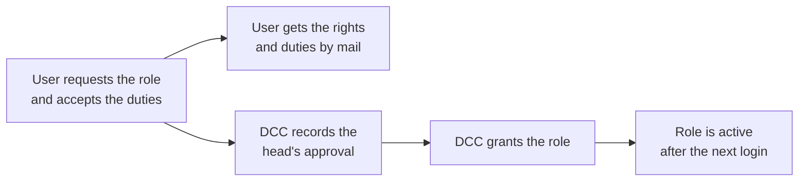

# Governance manager

The governance manager puts the rules for knowledge bases (Wissensspeicher) in Bebbi Bot into practice, as the DSFA "KI-Prototypen" requires them. Owners declare their knowledge bases and confirm them once a year, staff find shared knowledge bases in a directory, and the knowledge admin role has a request process.

It is a page inside Bebbi Bot, not a separate app, and users open it with their normal login. A daily job sends the reminders and the report to DCC and deletes old chats.

## Who does what

| Who | What they do |
|---|---|
| Owner of a knowledge base | Declares it once, then confirms it every year |
| Everyone signed in | Searches the directory and asks an owner for access |
| User who wants the knowledge admin role | Requests it and accepts the rights and duties |
| DCC | Records the head's approval, grants the role, follows up on overdue and undeclared knowledge bases |

The start page shows each user what is open for them: declarations, confirmations and the state of their role request.

## Declaration and yearly confirmation

Every knowledge base needs a declaration from its owner. The form asks for:

* purpose, contact and how to get access
* whether the knowledge base holds personal data, and if so the reference to the DSFA
* that the protection needs assessment (SWA) is done
* that the head of the Dienststelle approved it
* who may see it in the directory, and whether it is listed at all

A declaration is due again one year after the last confirmation. The owner then confirms that the knowledge base is still needed, that the documents were reviewed and that the sharing was reviewed. The owner can also change the declaration at that point.

An overdue confirmation has no automatic consequence. Nothing is unshared and no file is deleted. The owner gets reminders, DCC sees the knowledge base in its report and follows up.

## Directory and visibility

The directory lists the declared knowledge bases whose owners chose to list them, grouped by Departement and Dienststelle. "Zugang anfragen" opens a mail to the people who manage that knowledge base.

Visibility follows the canton's organisation. Each user belongs to an org unit, taken from their account at login: the Departement, then the Dienststelle and any levels below. The owner picks who sees an entry, from the whole canton down to their own unit. A user sees an entry if they belong to that unit.

A knowledge base with personal data may only serve one public organ (DSFA, ban on data pools). It can therefore be visible at most within a Dienststelle, and it needs a reference to the DSFA.

## Knowledge admin role

Knowledge admins may build and share their own assistants in Bebbi Bot. The role request follows the DSFA:

A user has one open request at a time.

## Reminders and the report to DCC

| Mail | When |
|---|---|
| Reminder to the owner | When a declaration is missing, a confirmation is due within 30 days, or it is overdue. One mail lists all of the owner's knowledge bases that need attention, and it comes again every two weeks until they are done |
| Rights and duties | Once per role request |
| Report to DCC | At most once a week, when there is something to follow up: overdue or missing declarations, knowledge bases with personal data that are shared too widely, open role requests |

Nothing is taken away or deleted because of a finding in the report. DCC follows up with the people concerned.

## Chat retention

Chats are deleted one year after their last use, together with the files uploaded in them. Two weeks before, the owner gets a mail that lists the chats and their deletion dates. Writing in a chat again starts the year over. No chat is deleted without that notice.

Knowledge base files are never deleted automatically. Their owners confirm every year that they are still needed.

## How it fits in

The governance manager keeps no copy of the knowledge bases. It reads them from Bebbi Bot directly, so a new knowledge base shows up as undeclared right away and a deleted one disappears. The declarations, role requests and an audit log of what happened are stored with Bebbi Bot's own data.

The page and its interface ship in the [custom image](/apps/bebbi-bot/image.md). The reminders, the report and the chat retention are steps of the [janitor](/apps/bebbi-bot/seeder-janitor.md#janitor).
