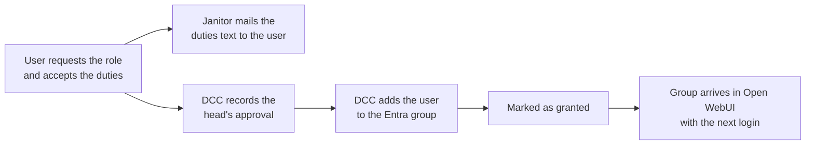

# Governance manager

The governance manager covers the rules for knowledge bases (Wissensspeicher) in Bebbi Bot, as the DSFA "KI-Prototypen" V2.2 requires them: chapter 6, the measures in 7.4 and the duties of knowledge admins in annex 4.1.

It is a page inside Open WebUI at `/bebbi-bot/governance/`, not a separate app. Users reach it with their Bebbi Bot login. The page, its API and the org unit lookup at login ship in the [custom image](/apps/bebbi-bot/image.md). The reminders, the report to DCC and the chat retention run in the [janitor](/apps/bebbi-bot/seeder-janitor.md#janitor).

## Who does what

| Who | What they do on the page |
|---|---|
| Owner of a knowledge base | Declares it once, then confirms it every year |
| Everyone signed in | Searches the directory of knowledge bases and asks an owner for access |
| User who wants the knowledge admin role | Requests it and accepts the rights and duties |
| DCC (Open WebUI admins) | Records the head's approval, adds the user to the Entra group, follows up on overdue and undeclared knowledge bases |

The start page shows each user what is open for them: declarations, confirmations, the state of their role request and, for DCC, the requests waiting on DCC.

## Declaration and yearly confirmation

Every knowledge base needs a declaration from its owner. The form asks for:

* purpose, contact and how to get access
* whether the knowledge base holds personal data, and if so the DSFA reference
* that the protection needs assessment (SWA) is done
* that the head of the Dienststelle approved it
* who may see it in the directory, and whether it is listed there at all

A declaration is due again 365 days after the last confirmation. Once it is due, the owner sees the declared values and confirms three things: the knowledge base is still needed, the documents were reviewed, and the sharing was reviewed. "Angaben ändern" opens the form prefilled. Saving it counts as a confirmation.

An overdue confirmation has no automatic consequence. Nothing is unshared and no file is deleted. The janitor reminds the owner and reports the knowledge base to DCC, and DCC follows up. Knowledge base files are never deleted automatically.

DCC can declare an undeclared knowledge base for its owner and correct a declared one. A correction leaves the confirmation date and the due date as they are, because the yearly review stays with the owner.

## Directory and visibility

The directory lists the declared knowledge bases whose owners chose to list them, grouped by the owner's Departement and Dienststelle. "Zugang anfragen" opens a mail to the owner and to the knowledge admins with write access to that knowledge base.

Visibility follows the org tree from Entra ID. Two user attributes, "Firma" and "Abteilung" in Teams and Outlook, give each user an org path:

```text
companyName = Präsidialdepartement
department  = Statistisches Amt\Data Competence Center
org path    = [Präsidialdepartement, Statistisches Amt, Data Competence Center]
```

The owner picks a scope, which is the start of their own org path. An empty scope means the whole canton, one segment the Departement, two segments the first level of the Abteilung, and so on. A user sees an entry if their org path starts with the entry's scope. Users without org data see only canton-wide entries.

A knowledge base with personal data may only serve one public organ (DSFA 6.2, the ban on data pools). Its scope therefore needs at least two segments, and it needs a DSFA reference. The admin view flags knowledge bases with personal data that are shared publicly.

Open WebUI reads the org path from Microsoft Graph at every login (`/me?$select=companyName,department`) and stores it on the server. It does not use `user.info`, because users can edit that themselves. A user gets their org unit at the first login after the rollout.

## Knowledge admin role

The role "Wissensspeicher-Admin" from annex 4.1 of the DSFA is membership in the Entra group `GG-OD-StatA-OpenWebUi-KnowledgeAdmin`. Only its members may build and share models in Workspace → Models. The role request goes like this:



DCC adds the user to the group by hand. Doing it automatically would need the Graph application permission `GroupMember.ReadWrite.All`. A user has at most one open request. After a grant, a new request is refused for 28 days, the time it takes the group to reach every session.

## Reminders and the weekly report

The janitor sends the mails once a day:

| Mail | When |
|---|---|
| Reminder to the owner | Declaration missing 14 days after the knowledge base was created, confirmation due within 30 days, or overdue. Again every 14 days; one mail lists all of the owner's knowledge bases that need it |
| Rights and duties | Once per role request, with the text the user accepted |
| Report to DCC | At most once a week, and only when there is something to report: overdue confirmations, knowledge bases undeclared for more than 14 days, public ones with personal data, open role requests, group members without a granted request, granted roles that have not reached Open WebUI yet, and duties mails the relay refused |

The janitor records each mail right after sending it, and only one run works at a time, so a run that fails halfway does not send a mail twice. Nothing is taken away or deleted because of a finding in the report.

## Chat retention

Chats are deleted 365 days after their last use (DSFA 7.4). The owner gets one mail 14 days ahead that lists the chats with their deletion dates. Writing in a chat again starts the period over. Files uploaded in a deleted chat go with it. No chat goes without that notice. On the first run, old chats are deleted 14 days after the mail. Feedback rows older than the retention period go too.

## How it is built

| Part | Where |
|---|---|
| API and page installation | `bebbi_bot_governance` package in the custom image, a Python hook like the others. Routes under `/api/v1/bebbi-bot/governance/`, checked with Open WebUI's own login |
| Page | `governance_ui/`, a Nuxt SPA with `@dcc-bs/common-ui.bs.js`, built to static files in the image |
| Org unit at login | The Entra group sync hook reads Graph `/me` and the governance hook stores the result |
| Mails, report, retention | Janitor steps `clean_governance` and `clean_chats` |

The governance manager keeps no copy of the knowledge bases. It reads Open WebUI's own tables (`knowledge`, `knowledge_file`, `access_grant`, `user`, `group`, `group_member`) on every request. A knowledge base appears as undeclared as soon as someone creates it, and disappears when it is deleted. Only what Open WebUI has no place for lives in our own tables, in Open WebUI's database with the prefix `bebbi_bot_`:

| Table | Content |
|---|---|
| `bebbi_bot_gov_declaration` | One declaration per knowledge base, with scope, personal data, confirmation and due date |
| `bebbi_bot_gov_role_request` | Role requests with the duties text the user accepted and DCC's decisions |
| `bebbi_bot_gov_user_org` | Org unit per user, from Graph |
| `bebbi_bot_gov_event` | Audit log: declarations, confirmations, decisions, mails sent |
| `bebbi_bot_retention_notice` | Retention notices sent |

Open WebUI creates and migrates these tables at startup, under a Postgres lock so several pods migrate once. Migrations only add, so an older image still runs on a newer schema. The janitor creates no tables. It reads the schema version and waits for the Open WebUI image, so the image goes out before a seeder image that needs a newer schema.

An Open WebUI upgrade has to check that these tables and columns still exist. The upgrade checklist in the repository lists them.

## Configuration

Open WebUI, in the `open-webui` env of the chart:

| Variable | Default | Meaning |
|---|---|---|
| `BEBBI_BOT_ENABLE_GOVERNANCE` | `True` | Page, API and org capture. Switched off, the tables are still migrated, because chat retention uses them |
| `BEBBI_BOT_GOVERNANCE_KNOWLEDGE_ADMIN_GROUP` | `GG-OD-StatA-OpenWebUi-KnowledgeAdmin` | Group whose members are knowledge admins |

The org capture also needs `DCC_ENABLE_ENTRA_TRANSITIVE_GROUP_SYNC=True` and `ENABLE_OAUTH_GROUP_MANAGEMENT=True`.

Janitor, in `values.yaml` under `janitor:`:

| Value | Default | Meaning |
|---|---|---|
| `retention.days` | `365` | Days after the last use until a chat is deleted. `0` turns retention off |
| `retention.noticeDays` | `14` | Days between the notice and the deletion |
| `retention.dryRun` | `true` | Log who would be warned and which chats deleted |
| `retention.maxNotices` | `500` | Users mailed per run at most |
| `retention.mailFrom` | `Bebbi Bot <dcc@bs.ch>` | Sender of all janitor mails |
| `governance.dryRun` | `true` | Log who would be reminded, send nothing |
| `governance.reportTo` | `dcc@bs.ch` | Recipients of the weekly report, comma-separated |

The mail relay comes from `secrets.smtpHost` and `secrets.smtpPort` in each stage's SOPS file. The janitor takes `WEBUI_URL` and the knowledge admin group from Open WebUI's env, so mails link to the right stage and the report checks the same group as the page.

## Rollout per stage

1. Roll out the Open WebUI image, then the seeder image, with both dry runs on.
2. Check that the Airlock WAF lets `/bebbi-bot/governance/` and `/api/v1/bebbi-bot/governance/` through.
3. Read the janitor logs of the first runs, then set `governance.dryRun` and `retention.dryRun` to `false`.
4. Link the page in the Open WebUI banner and tell the knowledge admins.

## Source

The full description, with the API rules, the mail handling and the tests, is `docs/governance.md` in `FD-ITBS/kdkp-open-web-ui`.
