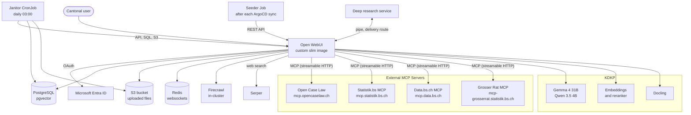

# Bebbi Bot

Bebbi Bot is the internal name of our [Open WebUI](https://docs.openwebui.com/) deployment. Cantonal staff use it as a general AI assistant: chat, summarize, draft and edit texts, work with uploaded documents, create Word, Excel, PowerPoint and PDF files, search the web, and run longer research jobs.

We do not fork Open WebUI. We run the upstream project and add our own pieces around it. This section documents only those additions. For everything Open WebUI does by itself (chats, knowledge bases, user settings), read the [official documentation](https://docs.openwebui.com/).

| Page | What it covers |
|---|---|
| [Custom image](/apps/bebbi-bot/image.md) | What we change inside the Open WebUI container image |
| [Seeder and janitor](/apps/bebbi-bot/seeder-janitor.md) | How models, tools and settings get into Open WebUI from git, and the daily cleanup job |
| [Tools and workspace content](/apps/bebbi-bot/tools.md) | The tools, filters, skills, prompts and tool servers that ship with Bebbi Bot |
| [Deep research](/apps/bebbi-bot/deep-research.md) | The research agent, and an explanation of pipes |
| [Governance manager](/apps/bebbi-bot/governance.md) | Declarations and yearly confirmation of knowledge bases, the directory, the knowledge admin role, chat retention |

## What users see

Four models are pinned in the model picker:

| Model | Purpose |
|---|---|
| Bebbi Bot | Default assistant. No internet access, so no data leaves the canton's infrastructure |
| Web Suche | Same assistant with web search. The user reviews every search query before it runs |
| Bebbi Bot - Tiefere Analyse | Same as Bebbi Bot with the model's thinking mode on. Slower, better for hard questions |
| Web Suche - Tiefere Analyse | Web search plus thinking mode |

All four use Gemma 4 31B from the [KDKP](/infrastructure/index.md). Their system prompt is German, in the style of the canton's administration, and tells the model which tools it has.

The deep research models ("Deep Research · Recht", "Deep Research · Grosser Rat" and so on) appear next to them when the research service is deployed. See [Deep research](/apps/bebbi-bot/deep-research.md).

Two more models exist but stay hidden from users: Gemma 4 31B and Qwen 3.5 4B as plain base models. The four models above build on the first one, and Open WebUI uses the small Qwen model for background tasks such as chat titles and follow-up questions.

## Images in documents

The content of pictures inside documents is not understood: charts, photos and diagrams. This holds for documents in a knowledge base (Wissensspeicher) and for documents attached to a chat. Text is not affected, including printed text on scanned pages, because OCR is on (`do_ocr: true` in `DOCLING_PARAMS`).

The cause is the text extraction for uploads. Docling extracts the text, and our [image](/apps/bebbi-bot/image.md) asks it to export each picture as a placeholder in the markdown. No picture description is configured. Only text is chunked and embedded.

Only an image file uploaded directly into a chat goes to the vision-capable model (Gemma 4 31B accepts image input) and is analysed.

Workaround: upload the image into the chat together with the question. If a fact lives only in a picture of a document, add it to the document as text.

## Architecture

## What we add on top of Open WebUI

* A [custom container image](/apps/bebbi-bot/image.md) built on upstream's slim image. It adds root certificates, extra Python packages for the in-browser code runner, the canton's Office templates, a nested-group login fix for Entra ID and a few small patches.
* A [seeder](/apps/bebbi-bot/seeder-janitor.md) that keeps models, tools, functions, skills, prompts, tool servers and admin settings in git instead of in the database.
* A [janitor](/apps/bebbi-bot/seeder-janitor.md#janitor) that deletes what Open WebUI leaves behind and enforces a policy on models users build themselves.
* [Tools](/apps/bebbi-bot/tools.md) to create and edit Office files, a web search tool with a review step, and connections to external MCP servers (Open Case Law, [Statistik.bs MCP](/mcp/statistik-bs.md), [Data.bs.ch MCP](/mcp/data-bs.md), and [Grosser Rat MCP](/mcp/grosser-rat.md)).
* A [deep research agent](/apps/bebbi-bot/deep-research.md), connected to Open WebUI through a pipe function.
* A [governance manager](/apps/bebbi-bot/governance.md) for the DSFA rules on knowledge bases: declarations, yearly confirmation, a directory, the knowledge admin role and chat retention.

## Deployment

The Kubernetes configuration lives in `apps/ki-app-openweb-ui` of the `kdkp-kiw-k8s-config` repository and is deployed with ArgoCD, like the other KDKP apps. The Helm chart wraps the upstream Open WebUI chart and adds templates for Firecrawl, the seeder Job, the janitor CronJob, the OpenTelemetry collector and the gateway route. Stage differences (test, uat, prod) sit in one values file per stage.

| Part | Choice |
|---|---|
| Database | PostgreSQL with pgvector as vector store |
| File storage | S3 |
| Websocket state | Redis, so several pods can serve one stage |
| Login | Microsoft Entra ID, with group sync |
| Embeddings, reranking, document extraction | External services on the KDKP (Qwen3-Embedding-4B, Docling) |
| Web page loading | Firecrawl, deployed in the same namespace |
| Web search | Serper |
| Metrics | OpenTelemetry collector, scraped by the cluster's Prometheus |

Pods have no shared read-write volume, because the cluster offers none. Each pod gets its own ephemeral volume for caches and upload copies. Everything that must survive lives in PostgreSQL or S3.

Open WebUI 0.12 changed the database schema and cannot run old and new pods side by side. A major upgrade therefore stops all pods first and lets a single pod run the migration. The steps are in the README of the k8s app.

## Source code

| Repository | Content |
|---|---|
| `FD-ITBS/kdkp-kiw-k8s-config` | Helm chart and values of all stages |
| `FD-ITBS/kdkp-open-web-ui` | Custom image, seeder, janitor and all seeded content |
| [DCC-BS/bebbi-deep-research](https://github.com/DCC-BS/bebbi-deep-research) | Research service and the pipe |

The two `FD-ITBS` repositories are internal to the IT BS GitHub organization.
