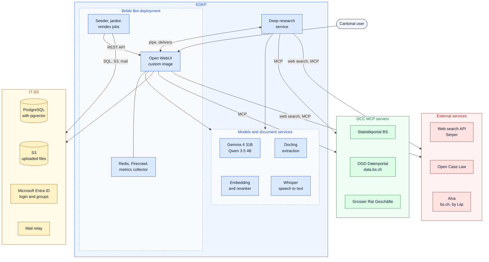

# Bebbi Bot

Bebbi Bot is the internal name of our [Open WebUI](https://docs.openwebui.com/) deployment. Cantonal staff use it as a general AI assistant: chat, summarize, draft and edit texts, work with uploaded documents and knowledge bases, create Word, Excel, PowerPoint and PDF files, search the web, query cantonal data sources, and run longer research jobs.

We do not fork Open WebUI. We run the upstream project and add our own pieces around it. This section documents only those additions. For everything Open WebUI does by itself (chats, knowledge bases, user settings), read the [official documentation](https://docs.openwebui.com/).

| Page | What it covers |
|---|---|
| [Custom image](/apps/bebbi-bot/image.md) | What we change inside the Open WebUI container image, and how each change is checked |
| [Seeder, janitor and reindex](/apps/bebbi-bot/seeder-janitor.md) | How models, tools and settings get into Open WebUI from git, the daily cleanup job, and the reindex of knowledge bases |
| [Tools and workspace content](/apps/bebbi-bot/tools.md) | The tools, filters, skills, prompts and MCP servers that ship with Bebbi Bot |
| [Knowledge bases and citations](/apps/bebbi-bot/knowledge.md) | How documents are extracted, chunked and found, and how every answer points to its passage |
| [Deep research](/apps/bebbi-bot/deep-research.md) | The research agent, and an explanation of pipes |
| [Governance manager](/apps/bebbi-bot/governance.md) | Declarations and yearly confirmation of knowledge bases, the directory, the knowledge admin role, chat retention |
| [Repository and releases](/apps/bebbi-bot/repository.md) | Folder structure of `kdkp-open-web-ui`, local development, CI, image tags and the upgrade routine |

## What users see

Four models are pinned in the model picker:

| Model | Purpose |
|---|---|
| Bebbi Bot | Default assistant. No web search. A query leaves the canton's infrastructure only if the user switches on an external MCP server in the chat |
| Web Suche | Same assistant with web search. The user reviews every search query before it runs |
| Bebbi Bot - Tiefere Analyse | Same as Bebbi Bot with the model's thinking mode on. Slower, better for hard questions |
| Web Suche - Tiefere Analyse | Web search plus thinking mode |

All four use Gemma 4 31B from the [KDKP](/infrastructure/index.md). Their system prompt is German, in the style of the canton's administration, and tells the model which tools it has. They share the same tools: the Office tools, the knowledge base search, sub-agents, the code interpreter, task lists, memory and a clarifying question to the user.

A fifth model, "Deep Research", appears when the research service is deployed. It asks which research profile fits the task (law, Grosser Rat, statistics and so on), then plans and queues a research job. See [Deep research](/apps/bebbi-bot/deep-research.md).

Two more models exist but stay hidden from users: Gemma 4 31B and Qwen 3.5 4B as plain base models. The four models above build on the first one. Open WebUI uses the small Qwen model for background tasks such as chat titles, tags, follow-up questions and search queries for knowledge bases.

Staff with the knowledge admin role can build their own assistants in Workspace → Models, for example a model that always searches one knowledge base. The [janitor](/apps/bebbi-bot/seeder-janitor.md#model-policy) holds those models to a fixed policy, so a user model cannot switch on web search or image generation.

## Images in documents

The content of pictures inside documents is not understood: charts, photos and diagrams. This holds for documents in a knowledge base (Wissensspeicher) and for documents attached to a chat. Text is not affected, including printed text on scanned pages, because Docling runs OCR.

The cause is the text extraction for uploads. Docling extracts the text, and our [image](/apps/bebbi-bot/image.md) asks it to export each picture as a placeholder in the markdown. No picture description is configured. Only text is chunked and embedded.

Only an image file uploaded directly into a chat goes to the vision-capable model (Gemma 4 31B accepts image input) and is analysed.

Workaround: upload the image into the chat together with the question. If a fact lives only in a picture of a document, add it to the document as text.

## Architecture

The colors show who runs each part. Bebbi Bot itself and the models run on the KDKP. IT BS provides the database, file storage, login and mail. DCC builds and runs the MCP servers for cantonal data. Everything else is an external service on the internet.

| Color | Owner | Parts |
|---|---|---|
| Blue | KDKP | The Bebbi Bot deployment (Open WebUI, Redis, Firecrawl, seeder, janitor, reindex, metrics), the deep research service, the language models, embedding, reranker, Docling and Whisper |
| Amber | IT BS | PostgreSQL, S3, Microsoft Entra ID, mail relay |
| Green | DCC | The MCP servers for the Statistikportal, the open data portal and the Grosser Rat |
| Red | External | Serper for web search, Open Case Law, Alva |

What leaves the canton's infrastructure: web search queries (only on the Web Suche models, after the user has reviewed them), the pages Firecrawl loads for them, and tool calls to the external MCP servers. Every MCP call shows in the chat with its arguments.

## What we add on top of Open WebUI

* A [custom container image](/apps/bebbi-bot/image.md) built on upstream's slim image. It adds root certificates, Python packages for the in-browser code runner, the canton's Office templates, a nested-group login fix for Entra ID, citation badges for MCP servers and knowledge bases, a Docling loader that survives long conversions, the governance page, a CSP report endpoint and tool metrics. Each change is a small hook that fails loudly when upstream code moves.
* A [seeder](/apps/bebbi-bot/seeder-janitor.md) that keeps models, tools, functions, skills, prompts, tool servers, group permissions and admin settings in git instead of in the database.
* A [janitor](/apps/bebbi-bot/seeder-janitor.md#janitor) that deletes what Open WebUI leaves behind, enforces a policy on models users build themselves, deletes old chats after a notice and keeps an audit log of every deletion.
* A [reindex job](/apps/bebbi-bot/seeder-janitor.md#reindex) that rebuilds all knowledge bases from the original files after a change of chunking, embedding model or Docling.
* [Tools](/apps/bebbi-bot/tools.md) to create and edit Office files, a web search tool with a review step, and connections to five MCP servers.
* [Retrieval settings and citation fixes](/apps/bebbi-bot/knowledge.md) for knowledge bases, so each badge opens the one passage a statement comes from.
* A [deep research agent](/apps/bebbi-bot/deep-research.md), connected to Open WebUI through a pipe function.
* A [governance manager](/apps/bebbi-bot/governance.md) for the DSFA rules on knowledge bases.

## Deployment

The Kubernetes configuration lives in `apps/ki-app-openweb-ui` of the `kdkp-kiw-k8s-config` repository and is deployed with ArgoCD, like the other KDKP apps. The Helm chart wraps the upstream Open WebUI chart and adds templates for Redis, Firecrawl, the seeder Job, the janitor and reindex CronJobs, the OpenTelemetry collector, a PodDisruptionBudget and the gateway route. Stage differences (test, uat, prod) sit in one values file per stage.

| Part | Choice |
|---|---|
| Database | PostgreSQL with pgvector as vector store |
| File storage | S3 |
| Websocket state | Redis, so several pods can serve one stage |
| Login | Microsoft Entra ID, with group sync including nested groups |
| Language models | Gemma 4 31B for chats, Qwen 3.5 4B for background tasks, both on the KDKP |
| Embeddings and reranking | Qwen3-Embedding-4B and Qwen3-Reranker-4B on the KDKP, hybrid search with BM25 |
| Document extraction | Docling on the KDKP, called through its asynchronous task API |
| Speech to text | Whisper on the KDKP |
| Web search | Serper |
| Web page loading | Firecrawl, deployed in the same namespace |
| Metrics | OpenTelemetry collector, scraped by the cluster's Prometheus |
| Content Security Policy | Report-only on test, violations are logged before it is enforced |

Pods have no shared read-write volume, because the cluster offers none. Each pod gets its own ephemeral volume for caches and upload copies. Everything that must survive lives in PostgreSQL or S3.

The public route blocks `/api/v1/dcc/deep-research`. Only the deep research service inside the cluster calls it.

Both images are pinned by tag and digest in the values, for example `v0.12.4-slim-202610261430-53160ab@sha256:...`. Renovate proposes each new build as a pull request, and a rollback is the revert of that line. See [Repository and releases](/apps/bebbi-bot/repository.md#releases).

## Source code

| Repository | Content |
|---|---|
| `FD-ITBS/kdkp-kiw-k8s-config` | Helm chart and values of all stages |
| `FD-ITBS/kdkp-open-web-ui` | Custom image, governance page, seeder, janitor, reindex, all seeded content, tests and benchmarks. Layout on [Repository and releases](/apps/bebbi-bot/repository.md) |
| [DCC-BS/bebbi-deep-research](https://github.com/DCC-BS/bebbi-deep-research) | Research service and the pipe |
| [DCC-BS/deep-research-evaluation](https://github.com/DCC-BS/deep-research-evaluation) | Local copy of the production model stack, used for evaluations and end-to-end tests |

The two `FD-ITBS` repositories are internal to the IT BS GitHub organization.
