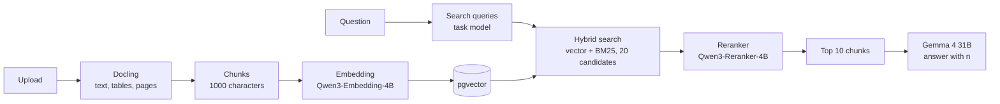

# Knowledge bases and citations

Staff upload laws, guidelines and internal documents into knowledge bases (Wissensspeicher) or attach files to a chat, and ask questions about them. Two things decide whether the answer is useful: the search must find the right passage, and the citation must open that passage. Open WebUI's defaults did neither well for our documents. This page describes the pipeline as it runs today and the measurements behind each setting.

User feedback started it: answers from a knowledge base were right, but the citation pointed to the wrong source or the wrong passage.

## From upload to answer

1. **Extraction.** Docling converts PDF and Office files to Markdown, with tables and the page of each block. OCR runs on scanned pages. Pictures become placeholders (see [Images in documents](/apps/bebbi-bot/index.md#images-in-documents)).
2. **Chunking.** Open WebUI splits by Markdown headings, then into chunks of about 1,000 characters with 150 characters overlap. Small pieces are merged up to 1,000 characters.
3. **Embedding.** Qwen3-Embedding-4B on the KDKP. Queries get a task instruction in front ("Given a question from staff of a Swiss public administration, retrieve passages…"), documents do not. Each file sends at most two embedding requests at a time, so a question does not wait behind a large upload.
4. **Search queries.** The task model writes two or three queries from the question and the chat history.
5. **Hybrid search.** Vector search and BM25 over the chunk text with its file name and headings, 20 candidates per query, equal weight.
6. **Reranking.** Qwen3-Reranker-4B scores the candidates. The best 10 per query go into the context.
7. **Answer.** Each chunk is a numbered source. The model cites with `[n]`, and each badge opens the one passage it points to.

A workspace model with attached knowledge takes the same path. Before the model runs, the [image](/apps/bebbi-bot/image.md#knowledge-bases-citations-and-retrieval) retrieves from its knowledge bases as above. The model can search again with the knowledge tool, which reranks its results from the full candidate set.

## Search queries

The biggest loss was in the queries, not in the search. Open WebUI's template asks the task model for "1-3 broad" queries. Gemma dropped the specific terms of the question and added sources the question did not name, for example a federal law article for a question about the cantonal staff law.

Our German template, seeded from `configs/tasks.json`:

* The first query is the question itself, as a full sentence, with references to earlier messages resolved ("und bei Teilzeit?" becomes the full question).
* One or two more queries name the key terms, with synonyms.
* Numbers, places, names, laws and terms of the question stay unchanged. Nothing is added that the question and the chat do not contain.
* A thank-you or a request to rephrase gives no query.

## Citations per passage

Three faults, found with an end-to-end suite and fixed in the image:

| Fault | Effect | Fix |
|---|---|---|
| Open WebUI numbers sources by file name | All retrieved chunks of a file share one badge, which opens 3.1 chunks on average. The user cannot see which passage a statement comes from | Each chunk is its own source, labelled with file and page or paragraph: `Personalgesetz.pdf · S. 4`, `SG_162.100.md · § 28–29`. The badge opens the PDF on that page |
| Sub-agents return only text | Their sources stay in the sub-agent's chat. Their `[n]` point to the parent's sources or nowhere | The sub-agent's sources come along into the parent answer |
| Every web search starts at 1 | The `[1]` of a second search opens a page of the first | The search tool numbers after the sources already on the answer |

The filter `citation_cleanup` removes markers without a source after each answer. Where the model wrote a source's label in brackets instead of its number, the filter puts the number in.

## Measurements

All measurements ran on the local copy of the production stack: Gemma 4 31B NVFP4 on vLLM, thinking off, the production system prompt. The corpus is nine Basel-Stadt staff and data protection laws, picked because neighbouring laws use similar words, so a wrong file or paragraph is easy to cite. 30 questions name the exact text that holds each fact.

### Citations

Facts per mode, 3 runs per question. "Right" means a `[n]` in the fact's line opens a source that contains the fact.

| Mode | Right before → after | Chunks a badge opens |
|---|---|---|
| Knowledge base attached in the chat | 69 → 64 of 114 | 3.1 → 1.0 |
| Workspace model with knowledge | 103 → 101 of 114 | 2.6 → 1.0 |
| Sub-agents | 0 → 43 of 48 | – → 1.4 |
| Two web searches in one answer | 14 → 27 of 36 | 1.2 → 1.2 |

For knowledge bases the share of found facts that were cited right stayed at about 96 %. The change is that the badge now opens the one passage. The differences in absolute numbers come from retrieval noise between runs.

### Retrieval settings

Recall measured without the model, through Open WebUI's own search endpoint, with the real queries Gemma wrote in 360 chats. A fact counts when a returned chunk contains its text.

| Setting | Facts found (of 228) | Context per answer |
|---|---|---|
| Before: 2,000-character chunks, 5 per query, upstream query template | 140 (61 %) | 15,300 characters |
| No reranker | 116 (51 %) | |
| The question alone as query | 210 (92 %) | 8,100 characters |
| New query template | 222 (97 %) | 14,000 characters |
| New template, 1,000-character chunks, 10 per query | 228 (100 %) | 14,700 characters |

A second corpus, 44 public federal records management documents with 85 questions, confirmed the direction. The question alone works for specific questions and fails for general ones. The new template works for both.

What else came out:

* **Keep the reranker, with its prompt template.** vLLM serves Qwen3-Reranker as a classifier only with its own chat template. Without it the scores barely separated relevant from unrelated chunks, and the title chunk of every law came first. The KDKP deployment now starts the reranker with the template.
* **Keep the enriched hybrid search.** Without it, pgvector's native full-text search requires every word of a query in one chunk and adds nothing for real queries. The BM25 weight and more than 20 candidates made no difference.
* **Query instruction for the embedding.** A small gain with the reranker, a large one without. It is the fallback when the reranker is down.
* **Sources in the user message.** Open WebUI can put the retrieved sources into the system message or in front of the user message (`RAG_SYSTEM_CONTEXT`). In the system message, behind 34,000 characters of system prompt and MCP instructions, Gemma often answered without markers. We prepend them to the user message.

### Searching again

Some answers need a second search, for example when a passage says "Kündigungsfristen gemäss § 28 des Personalgesetzes". Gemma 4 with thinking off almost never searched again by itself: 0 of 33 answers, whether the rule was in the tool description, the tool result or the system prompt. Retrieving the model's knowledge up front, with the new query template, found the follow-up provision in most cases. On the knowledge suite, the workspace-model path went from 88 % to 98 % of facts right, none wrong.

## Tables

Tables were cut in the middle, and the search returned many unrelated chunks. A benchmark (`benchmarks/rag_chunking`) splits real Docling output of synthetic administrative documents with Open WebUI's own code and measures recall, how many chunks start with table rows but no header, and how much irrelevant text comes back. It ran alongside the chunk size change.

## Changing the pipeline

A change of chunking, embedding model or Docling applies only to files processed afterwards. Run the [reindex job](/apps/bebbi-bot/seeder-janitor.md#reindex) after such a change. Do not use Open WebUI's reindex button: it re-chunks the stored text without Docling, and every chunk loses its page number.
