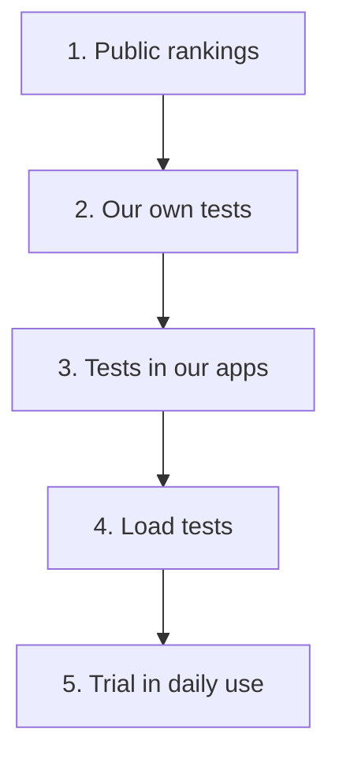

# How we test

We test every model in five rounds. Each round answers one question. A model that does well in a public ranking still has to prove itself on our material, inside our apps and with many users at the same time.

Most of our test code is public, so anyone can look at it or use it. Our test data and results stay private, because they come from the daily work of real people. The [data policy](https://github.com/DCC-BS/ai-model-evaluation/blob/main/docs/data-policy.md) explains this in more detail.

The [repository](https://github.com/DCC-BS/ai-model-evaluation/blob/main/docs/eval-layers.md) has the technical details for each round.

## The five rounds

## 1. Public rankings

Is the model worth a closer look? We read public rankings and test results, listed in the [selection standard](/evaluation/selection-standard). Other people made these tests with their own data. They help us find candidates.

## 2. Our own tests

How well does the model handle material like ours? The code for these tests is in [ai-model-evaluation](https://github.com/DCC-BS/ai-model-evaluation).

- **Speech-to-text** ([stt](https://github.com/DCC-BS/ai-model-evaluation/blob/main/stt/README.md)). We use German and Swiss German recordings and count the words and letters the model gets wrong. The public example uses a few clips of read Standard German from the FLEURS collection. They only show that the code works. Our Swiss German recordings and results stay private.
- **Reading handwriting** ([ocr](https://github.com/DCC-BS/ai-model-evaluation/blob/main/ocr/README.md)). We use a public collection of German handwriting and count the words and letters the model gets wrong.
- **Synthetic voices** ([tts](https://github.com/DCC-BS/ai-model-evaluation/blob/main/tts/README.md)). We listen and follow a [written checklist](https://github.com/DCC-BS/ai-model-evaluation/blob/main/tts/LISTENING_PROTOCOL.md). There is no automatic score.
- **Anonymisation and decision models.** We test them with our own tests. That code isn't public yet.

## 3. Tests in our apps

Do our apps still work correctly with the new model?

- [bentoml-faster-whisper](https://github.com/DCC-BS/bentoml-faster-whisper) tests the transcription service, including how it tells speakers apart and how fast it is.
- [dcc-docling-serve](https://github.com/DCC-BS/dcc-docling-serve/tree/main/benchmarks) tests document conversion with made-up PDFs.
- [text-mate-backend](https://github.com/DCC-BS/text-mate-backend/tree/main/evals) tests the advice and simplification features of TextMate.
- [transcribo-backend](https://github.com/DCC-BS/transcribo-backend) and [bs-translator-backend](https://github.com/DCC-BS/bs-translator-backend) have tests that also run against a live model.
- [deep-research-evaluation](https://github.com/DCC-BS/deep-research-evaluation) tests the research assistant in Bebbi Bot.

## 4. Load tests

Does the model stay fast when many people use it at once? We send many requests at the same time to the live service and measure how it responds.

- [vllm-benchmark](https://github.com/DCC-BS/vllm-benchmark) covers chat, search, translation and image input.
- [bentoml-faster-whisper](https://github.com/DCC-BS/bentoml-faster-whisper) has its own load tests for speech-to-text.

## 5. Trial in daily use

How does the model behave in real work? For a while the old and the new model run side by side. Our apps get adjusted, and we watch how the new model does. There is no test code for this round. [Model lifecycle](/evaluation/lifecycle) describes the steps.

## What these rounds can't show you

- Round 2 runs on our private data. You can run the same tests on your own data, but you won't get our numbers.
- For synthetic voices we have only our ears and the checklist.
- Round 5 depends on people paying attention in daily use.
- Some of the repositories above contain test results from earlier work. This section doesn't add any.
