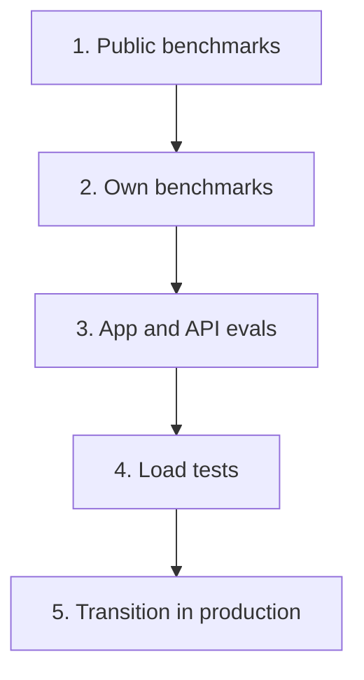

# How We Test

We test a model in five layers. Each layer answers one question, and no layer decides alone. A model that looks good on a public leaderboard still has to work on our kind of data, inside our apps and under real load.

Most of the code is public so that others can check it or reuse it. The test data and the results are not, because they contain work content from real people. See the [data policy](https://github.com/DCC-BS/ai-model-evaluation/blob/main/docs/data-policy.md).

Details per layer are in the [repository doc](https://github.com/DCC-BS/ai-model-evaluation/blob/main/docs/eval-layers.md).

## The five layers

## Layer 1: public benchmarks

Question: is this model worth a closer look? We read outside benchmarks and leaderboards, listed in the [selection standard](/evaluation/selection-standard). They use other people's data. They tell us where to look, not what to run.

## Layer 2: own benchmarks

Question: how good is it on our kind of data? These suites live in [ai-model-evaluation](https://github.com/DCC-BS/ai-model-evaluation).

- **Speech-to-text** ([stt](https://github.com/DCC-BS/ai-model-evaluation/blob/main/stt/README.md)): German and Swiss German recordings, scored with WER, CER and BLEU. It runs on a small public sample.
- **OCR** ([ocr](https://github.com/DCC-BS/ai-model-evaluation/blob/main/ocr/README.md)): vision-language models on a public German handwriting dataset, scored with CER and WER.
- **Text-to-speech** ([tts](https://github.com/DCC-BS/ai-model-evaluation/blob/main/tts/README.md)): judged by listening with a [written protocol](https://github.com/DCC-BS/ai-model-evaluation/blob/main/tts/LISTENING_PROTOCOL.md). There is no automated score.
- **PII/NER and decision models**: we evaluate them on our own benchmarks. The code is not public yet.

## Layer 3: app and API evals

Question: does the app or API still behave correctly with this model?

- [bentoml-faster-whisper](https://github.com/DCC-BS/bentoml-faster-whisper): unit, integration and performance tests for transcription and speaker separation.
- [dcc-docling-serve benchmarks](https://github.com/DCC-BS/dcc-docling-serve/tree/main/benchmarks): document conversion benchmarks on synthetic PDFs.
- [text-mate-backend evals](https://github.com/DCC-BS/text-mate-backend/tree/main/evals): evals for the advisor and simplify features.
- [transcribo-backend](https://github.com/DCC-BS/transcribo-backend) and [bs-translator-backend](https://github.com/DCC-BS/bs-translator-backend): route, service and integration tests, including tests against a live model.
- [deep-research-evaluation](https://github.com/DCC-BS/deep-research-evaluation): evaluation of the deep-research engine.

## Layer 4: load tests

Question: does it hold up under real concurrent traffic on the live API?

- [vllm-benchmark](https://github.com/DCC-BS/vllm-benchmark): load tests against live endpoints for chat, retrieval, translation and vision.
- Load tests in [bentoml-faster-whisper](https://github.com/DCC-BS/bentoml-faster-whisper) for speech-to-text.

## Layer 5: transition in production

Question: does it behave in real use? This is a process, not code. The old and new model run side by side while apps adapt and we collect what we see. See [Model Lifecycle](/evaluation/lifecycle).

## What the layers do not cover

- Layer 2 results come from our private data. You can run the method on your own data, but you cannot reproduce our numbers.
- TTS has no automated metric.
- Layer 5 depends on people watching real use. It has no test suite.
- Some public repositories above already contain result files of their own. This section adds none.
