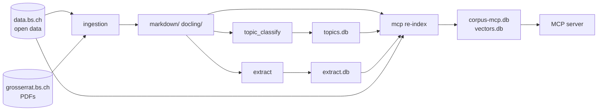

# Grosser Rat MCP

Searches the parliament of Basel-Stadt: every business item (Geschäft), motion (Vorstoss), report of the Regierungsrat (Ratschlag) and transcript (Protokoll) of the [Grosser Rat](https://grosserrat.bs.ch) since 1973.

| | |
|---|---|
| Endpoint | `https://mcp-grosserrat.statistik.bs.ch/mcp` |
| Corpus status | [/health](https://mcp-grosserrat.statistik.bs.ch/health) |
| Code | [DCC-BS/grossrat-bs-mcp](https://github.com/DCC-BS/grossrat-bs-mcp) (private), server in `mcp/`, contract in `mcp/spec.md` |
| Image | `ghcr.io/dcc-bs/grossrat-bs-mcp` |
| Data source | Open data of the Grosser Rat on data.bs.ch and the PDFs on grosserrat.bs.ch, converted to text and indexed |
| Version | 0.2.0, November 2026 |

::: info Private repository
The repository is private for now. Everything it uses is public (open data, PDFs, open-weight models), and all data can be rebuilt from scratch with its jobs.
:::

## The corpus

| | |
|---|---|
| Documents | about 54,200, about 797 million characters |
| Business items | about 21,200 |
| Period | 22 March 1973 to today |
| Legislature periods | 1992–1997 to the current one, 2025–2029 (since 1 February 2025) |
| Language | German |
| Most common document types | GR Beschluss, Schreiben des RR, Beschluss, texts of Interpellationen, Schriftliche Anfragen, Anzüge and Motionen, Ratschläge |

`get_corpus_stats` returns the current numbers and the legislature periods with their dates, and `list_facets` the document types, parties, business types and statuses in their exact spelling.

The published image carries the databases inside, about 3.3 GB compressed and 10 GB unpacked. The container needs no volume and no model server, because the embedding model runs on the CPU. See [How the data is built](#how-the-data-is-built) for where the databases come from and how the image is published.

## Three ways in: search, graph and lists

**Search** answers "where does it say that?". It is hybrid. A BM25 full-text index and passage vectors each find candidates, and the two rankings are fused.

* BM25 matches words. The index is SQLite FTS5 over title, author, party, text and the extract job's notes. Longer words are searched as prefixes and, through the index's own vocabulary, as the last part of a German compound, so "Velo" finds "Veloweg" and "Befragung" finds "Jugendbefragung".
* The vectors match meaning, so "Wechseljahre" finds "Menopause". Docling's `HybridChunker` cuts each document along its structure into passages of at most 512 tokens with heading path and page. About 770,000 passages are embedded with [granite-embedding-311m-multilingual-r2](https://huggingface.co/ibm-granite/granite-embedding-311m-multilingual-r2), covering 99.8 % of the documents. A faiss HNSW index finds the 600 nearest passages in about 2 ms; without it, sqlite-vec compares every vector (about 0.8 s).
* Reciprocal rank fusion (k = 60) merges the two rankings. The server embeds the query itself with onnxruntime on the CPU, about 13 ms, without torch in the image. Without vectors or a working model the search falls back to BM25 and reports `mode: "lexical"`.
* Each hit says how it was found (`found_by`). If `snippet_matched` is false, the snippet does not contain the search words, because the hit matched by meaning.

**The graph** answers "who?" and "which committees?". It links persons, committees (Gremien), parties, organisations, topics, sessions and business items. Every edge names its source: `ogd` for the open data (authorship, committee membership, referrals, votes, interests, agendas), `signatures` for co-signers read from the signature line of a motion, `llm` with the verbatim quote for what a model extracted, `classifier` for estimated topics. An edge exists only when both of its ends exist as nodes. A member who submitted 1,386 business items is fully listed by `explore_entity` and barely found by text search.

Entries and edges can be cited too. An entry's `url` is its public page. An edge's `url` points to where its fact comes from: the records on data.bs.ch for open data, the document opened at the quote for what a model read, the business item for a classified topic.

**Lists by date** answer "what did the council deal with in September?". `list_geschaefte` returns every business item that matches dates, status and kind, complete and unranked, and `list_members` the members on a given day.

## Tools

| Tool | What it does |
|---|---|
| `search_documents` | Passages from all documents, each with author, party, a `citation_url` and a `citation_label`. Filters: `partei`, `urheber`, `geschaeftsart`, `dokumentart`, `status`, `since`, `until`, `legislatur`. At most 50 hits per call. `mode='lexical'` lists every word match instead of the best-ranked candidates |
| `find_geschaefte` | Complete list of business items for a research question. Takes 3 to 10 phrasings, reads every hit to the end and returns each item once, with its page on grosserrat.bs.ch (`url`) and a `citation_label`. Default 25 items per page, `details` adds ranks and the Regierungsrat's documents. `group_by` (`urheber`, `partei`, `geschaeftsart`, `status`, `jahr`) counts instead of listing |
| `list_geschaefte` | Every business item with a proceeding (`dealt_since`, `dealt_until`) or a start (`begun_since`, `begun_until`) in a period, filtered by `legislatur`, `status` and `exclude_kinds`. Not ranked and complete. Each item has its topic, its submission and its latest proceeding. `group_by` counts by topic, kind, status or party |
| `list_members` | All members of the Grosser Rat on a day (`as_of`, default today) with party, constituency, parliamentary group on that day, terms of office and `node_id`. Filters `partei` and `wahlkreis` |
| `get_geschaeft` | Full dossier of a business item by signature, for example `17.5209`: master data, all documents, assignments, topic and the path through the council |
| `get_document` | Text of a document by `dok_laufnr`, one page or windows of 20,000 characters |
| `cite_document` | The PDF link that opens at a given page and phrase |
| `search_entities` | Finds graph entries by name and returns their `node_id` and public `url`. Several names per call |
| `explore_entity` | Everything attached to one or more entries, grouped by relation (for example `AUTHORED_BY`, `MEMBER_OF`) and paged per relation. Every edge has a source `url` |
| `connect_entities` | Shortest chain between two entries, up to `max_tiefe` steps. Each step cites the edge that leads to it |
| `list_facets` | Allowed filter values with counts |
| `get_corpus_stats` | Size and period of the corpus, and the legislature periods with `start`, `end` and `current` |
| `search`, `fetch` | The search and fetch pair that ChatGPT connectors expect. Same data as `search_documents` and `get_document` |

A result holds at most 40,000 characters, because clients set longer tool results aside where the model may not read them. Lists are cut to what fits and continue with `next_offset`.

The server also offers the prompt `recherche` ("Vollständige Recherche"). Given a question, it walks the model through a complete survey: several phrasings, every list read to the end, results checked.

## Using it well

The server's instructions tell the model these rules. They matter for anyone writing prompts or presets against it.

* **Lists need `find_geschaefte`.** "Which open motions concern X" is not answered by the first page of `search_documents`. Lower-ranked items and items worded differently get lost.
* **A list is complete only when `next_offset` is `null`.**
* **Counting goes through `group_by`.** "Who submitted most" or "how did it develop over the years" needs no listing. A count has no public page and so no `url`.
* **Dates, not words, go through `list_geschaefte`.** "What did the council deal with in September" or "which items begun since 2025 are still open" is a filter, not a search.
* **The current legislature is a filter.** `legislatur='current'` (or `'2025-2029'`) works on `search_documents`, `find_geschaefte` and `list_geschaefte`.
* **Transcripts need a filter.** A full transcript (Vollprotokoll) has about 600,000 characters, so BM25 ranks it below one-page motions. To find what was said in the council, search with `dokumentart='Vollprotokoll'`.
* **Copy filter values from `list_facets`.** Guessed spellings match nothing.
* **Members on a day go through `list_members`.** The open data has gaps before about 2005, so a date there can list only a few members.
* **Parties of former members.** The open data often lacks a party for them. `explore_entity` with `predicate='MEMBER_OF'` shows their parliamentary groups with dates. A group can unite several parties, for example "CVP/EVP", and the answer should say so.
* **Signatures, not `dok_laufnr`.** Every hit carries `dok_laufnr` (internal, only for `get_document`), `signatur_ges` (the council's business number, for example "17.5209") and a `citation_url` that opens the official PDF at the right page.

## How the data is built

The repository holds the whole pipeline, not only the server. Its parts know each other only through files. Each job follows the opendatabs [data-processing](https://github.com/opendatabs/data-processing) pattern: its own folder with a `Dockerfile`, `etl.py`, `data_orig/` for what it reads and `data/` for what it writes.

| Folder | Kind | What it does | Writes |
|---|---|---|---|
| `ingestion` | job | Fetches the council's PDFs and transcripts and converts them with docling-serve | `markdown/`, `docling/` |
| `topic_classify` | job | Gives every business item one of 46 topics, trained on the topics the parliamentary services assign themselves | `topics.db` |
| `extract` | job | Lets Gemma read documents and record relations with a verbatim quote | `extract.db` |
| `mcp` | service and job | The MCP server. Its re-index builds the full-text index, graph and vectors from everything above | `corpus-mcp.db`, `vectors.db`, `vectors.faiss` |
| `instances` | local tool | Starts docling-serve, Gemma and the Qwen embedding server on the GPUs | – |



**Sources.** Eleven open datasets of the Grosser Rat on data.bs.ch (business items, documents, proceedings, referrals, memberships, committees, interests, motions, votes, agendas), the PDFs on grosserrat.bs.ch, and open-weight models: [Gemma 4 26B](https://huggingface.co/nvidia/Gemma-4-26B-A4B-NVFP4) for extract, [Qwen3-Embedding-4B](https://huggingface.co/DCC-BS/Qwen3-Embedding-4B-FP8-Dynamic) for topics, granite for search.

**Order.** Ingestion runs first. Then topics, re-index and extract. `extract` reads the MCP database to know which documents and names exist, and a second re-index brings its relations in the same night. The Gemma readings and the vectors are only extended, never rebuilt. `corpus-mcp reindex` builds `corpus-mcp.db` beside the served file in under a minute and swaps it in when complete. It skips the build when its inputs are unchanged.

**Two ways to serve.** In the repository's own `compose.yml` the server mounts `corpus-mcp.db`, `vectors.db` and the Markdown read-only and picks up each re-index without a restart. The tools quote from the Markdown, not from the database. The image that the [facade](/mcp/hosting.md) runs is the *baked* variant with the data inside.

**Publishing.** CI checks and tests every project on each push and builds no images. `mise run deploy:mcp:local` builds the baked image, runs it on port 8010 and smoke-tests it. `mise run deploy:mcp` then pushes exactly that image as `ghcr.io/dcc-bs/grossrat-bs-mcp:<version>` and `:latest`. The version comes from `mcp/pyproject.toml`, and a published version is not overwritten. A new image version therefore also brings new data.

### Settings

From the environment or a `.env`, all with the prefix `MCP_`. The most relevant:

| Variable | Default | Meaning |
|---|---|---|
| `MCP_DATA_DIR` | `data` | Where `corpus-mcp.db`, `vectors.db` and `vectors.faiss` live |
| `MCP_SEMANTIC` | `true` | Whether search uses the vectors |
| `MCP_EMBED_BACKEND` | `onnx` | `onnx` (CPU, the server image) or `torch` (GPU, the re-index) |
| `MCP_ALLOWED_HOSTS` | `*` | Allowed `Host` headers, see [Hosting](/mcp/hosting.md#allowed-hosts) |
| `MCP_BUILD` | `dev` | The commit that `/health` shows |

### Local development

In `mcp/`:

```bash
uv sync
uv run corpus-mcp reindex          # build data/corpus-mcp.db
uv run corpus-mcp search "Velo"    # search from the command line
uv run corpus-mcp serve            # MCP over stdio
uv run pytest                      # builds a small corpus, needs no data and no GPU
mise run ci-check                  # lockfile, ruff format, ruff check, ty
```

## Endpoints

| Path | Answer |
|---|---|
| `/mcp` | MCP streamable HTTP |
| `/healthz` | `{"status":"ok"}` for the container healthcheck |
| `/health` | Version, build commit, number of documents, search mode, vector coverage and `index` (`hnsw` or `exact`) |

Opening the index and loading the embedding model takes time after a start. The compose healthcheck therefore allows 60 seconds before it counts failures.

## Open issues

The deep research evaluation of October 2026 produced a list of requested changes, kept in `docs/grossrat-mcp-changes.md` of [bebbi-deep-research](https://github.com/DCC-BS/bebbi-deep-research). The citation tests of Bebbi Bot added more, tracked in [Feedback#367](https://github.com/DCC-BS/Feedback/issues/367). Version 0.2.0 closed most of them:

* Legislature periods are in `get_corpus_stats` and work as a `legislatur` filter, so "in der laufenden Legislatur" no longer needs dates from the user.
* `find_geschaefte` returns 25 items by default instead of 100, and each item carries `url` and `citation_label`.
* `search_documents` hits have `urheber` and `partei` again.
* Entries, edges and chain steps of the graph carry a public `url` or the source of their fact.
* The instructions are down from 3,520 to about 1,400 characters and no longer prescribe a citation format.

Still open: counts from `group_by` have no public page, so answers based only on them have no source.
