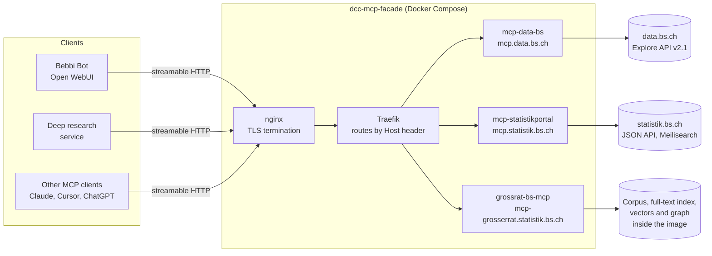

# MCP servers

The DCC builds and runs three [MCP](https://modelcontextprotocol.io/) servers that give language models access to public data of the canton of Basel-Stadt. A model calls their tools to search, read and cite. It does not have to guess figures or business numbers from memory.

| Server | Data | Endpoint | Code |
|---|---|---|---|
| [Data.bs.ch MCP](/mcp/data-bs.md) | Datasets of the open government data portal [data.bs.ch](https://data.bs.ch) | `https://mcp.data.bs.ch/mcp` | [DCC-BS/mcp-data-bs](https://github.com/DCC-BS/mcp-data-bs) |
| [Statistik.bs MCP](/mcp/statistik-bs.md) | Indicators, time series and web tables of [statistik.bs.ch](https://statistik.bs.ch) | `https://mcp.statistik.bs.ch/mcp` | [DCC-BS/mcp-statistikportal](https://github.com/DCC-BS/mcp-statistikportal) |
| [Grosser Rat MCP](/mcp/grosser-rat.md) | Every business item, document and transcript of the [Grosser Rat](https://grosserrat.bs.ch) since 1973 | `https://mcp-grosserrat.statistik.bs.ch/mcp` | Not public yet. Image `ghcr.io/dcc-bs/grossrat-bs-mcp` |

A fourth repository, [DCC-BS/dcc-mcp-facade](https://github.com/DCC-BS/dcc-mcp-facade), holds the Docker Compose stack that serves all three under their hostnames. See [Hosting](/mcp/hosting.md).

All endpoints are public and need no authentication. They only read data that is already public.

## Who uses them

* **[Bebbi Bot](/apps/bebbi-bot/index.md).** Open WebUI connects the three servers as tool servers, next to the external [OpenCaseLaw](https://mcp.opencaselaw.ch) server for Swiss law. See [Tools and workspace content](/apps/bebbi-bot/tools.md#mcp-tool-servers).
* **[Deep research](/apps/bebbi-bot/deep-research.md).** The research presets call a subset of the tools. The `grossrat` preset works almost only with the Grosser Rat server, `statistik` with data.bs.ch and statistik.bs.ch, and the legal and administration presets use them as helpers.
* **Anyone else.** Claude Desktop, Cursor, ChatGPT connectors, the Antigravity CLI and other MCP clients can use the same endpoints. The two open source servers also run locally over stdio with `uvx`.

## Architecture



The data.bs.ch and statistik.bs.ch servers are thin and stateless. They translate tool calls into requests to the portal's public API and reshape the answer for a model. The Grosser Rat server is different. It carries its own corpus of about 54,000 converted documents, a search index and an entity graph inside the image, and needs no outside service at runtime.

## Shared design

The servers follow the same rules. Most of them came out of evaluation runs with Gemma 4 in Bebbi Bot and the deep research agent, where a small model has to work with the results.

**Every result can be cited.** Results carry the public URL, the title and the date of the source (`url`, `portal_url`, `citation_url`, `modified`, `aktualisierungsdatum`). A model can quote the result of a single call and link the source without a second lookup.

* Each item also gets a short `citation_label` with the number an answer repeats, for example `data.bs.ch · Leerstehende Wohnungen` or `GR 23.5544 · Motion …`. Bebbi Bot shows it in its citation badges.
* Counts and aggregates link the public page that lists what was counted. For example, a publisher's dataset count links the data.bs.ch catalog filtered on that publisher.
* A result without a public page has no URL, and clients treat the answer as having no source.

Status: data.bs.ch [mcp-data-bs#9](https://github.com/DCC-BS/mcp-data-bs/pull/9), statistik.bs.ch [mcp-statistikportal#5](https://github.com/DCC-BS/mcp-statistikportal/pull/5) and [#6](https://github.com/DCC-BS/mcp-statistikportal/issues/6), Grosser Rat [Feedback#367](https://github.com/DCC-BS/Feedback/issues/367).

**Results fit into the context.** Large results are capped at about 12,000 characters (20,000 for Grosser Rat documents). A cut result says so with `truncated: true` and a `hint`, and offers `next_offset` to page on. The model knows that it has not seen everything.

**Errors tell the model what to do.** API failures come back as an MCP `ToolError` with the portal's own message, for example a wrong ODSQL field name, or with a pointer to the right tool ("check the indicator id with search_indicators"). A generic "Error executing tool" would leave the model guessing.

**Short tool descriptions and instructions.** Tool descriptions are sent with every model call, so they stay at one to three sentences.

Longer guidance goes into the server's `instructions`. Open WebUI appends them to the system message of every chat that has the server switched on, so they stay short as well (under about 1,500 characters) and only route: which tool answers what, and what the fields mean.

They prescribe no citation format. Rules like "link portal_url" or "cite the signature and this URL" made Gemma write Markdown links instead of Bebbi Bot's citation badges.

**Stateless streamable HTTP.** The MCP endpoint is `/mcp`. Requests need no `initialize` handshake and no session id, so any replica can answer and a restart loses nothing. `GET /healthz` answers `{"status":"ok"}` for the container healthcheck.

**Tolerant of simple clients.** The open source servers rewrite incomplete `Accept` headers to `application/json, text/event-stream`, so plain JSON-RPC clients work. `GET /` returns a JSON status page instead of holding an SSE connection open.

**Self-describing.** The open source servers generate an OpenAPI 3.1 description from the live tool registry at `/openapi.json` and serve Swagger UI at `/docs`. Every tool appears as a `tools/call` request with a working example.

**DNS rebinding protection.** `MCP_ALLOWED_HOSTS` lists the hostnames the server answers to. Behind nginx it must be the bare hostname, see [Hosting](/mcp/hosting.md#allowed-hosts).

## Development

The two open source servers share their layout: one `main.py` with the tools, `api_docs.py` for the OpenAPI page, tests in `tests/`, and the official [MCP Python SDK](https://github.com/modelcontextprotocol/python-sdk) with `httpx` and `uvicorn`. Tooling follows the [DCC Python standards](/coding/python.md) with [mise](/dev-setup/mise.md) and uv.

| Task | Alias | What it does |
|---|---|---|
| `mise run install` | `i` | Creates the venv (`uv sync --locked`) |
| `mise run dev` | `d` | Runs the server over stdio for local MCP clients |
| `mise run dev:http` | `dh` | Runs streamable HTTP on port 8000 |
| `mise run check` | `c` | Lockfile, format and lint (ruff) |
| `mise run test:unit` | `t` | pytest |

Debug a server interactively with the MCP inspector:

```bash
npx @modelcontextprotocol/inspector uv run main.py
```

CI uses the shared [ci-workflows](https://github.com/DCC-BS/ci-workflows). `ci.yml` runs `check` and `test:unit` on every push and pull request. `publish.yml` is started by hand: bump the version in `pyproject.toml`, run the workflow, and it pushes `ghcr.io/dcc-bs/<repo>:<version>` and `:latest`. The image builds on the shared [mise base image](/coding/docker-images.md) and runs as a non-root user.

### Skills instead of a server

Each open source repository also ships an agent skill (`skills/data-bs/SKILL.md`, `skills/statistik-bs/SKILL.md`). It teaches a coding agent to call the public REST API directly with curl or httpx, for agents where adding an MCP server is not worth it. Copy or link the folder into the agent's skills directory, for example `~/.agents/skills/data-bs`.
